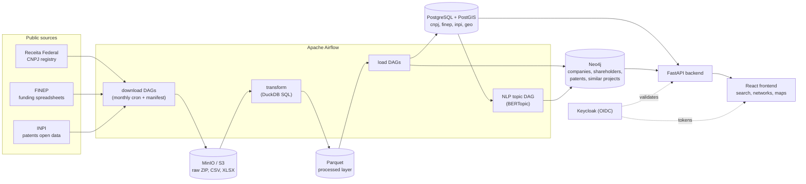

# OSINT Platform

An open-source intelligence platform for Brazilian public data. It ingests the federal company registry (CNPJ), FINEP innovation funding and INPI patents. It cleans the data at scale, then serves it as searchable relational tables and as a graph of company and shareholder relationships.

[Leia em português](README.pt-BR.md)

**Highlights**

- **Orchestrated ETL:** Apache Airflow DAGs for each source, from scheduled monthly downloads through transform and load to materialized-view refresh and graph loading.
- **Large-scale processing:** the CNPJ registry has tens of millions of companies and establishments. DuckDB SQL transforms one ~5M-row file in 3 to 4 seconds (about 4M rows/s), and Parquet shrinks it by about 70%.
- **Layered storage:** raw ZIPs and CSVs land in MinIO (S3 API) and are cleaned into Parquet, then loaded into PostgreSQL/PostGIS for search and Neo4j for networks.
- **Idempotent and traceable:** download manifests record every file and reference month, so nothing is downloaded or reprocessed twice. Changes on the source are detected with ETag/Last-Modified checks.
- **Schema as code:** Flyway migrations for each domain schema (`cnpj`, `finep`, `inpi`, `geo`), plus Cypher scripts for Neo4j constraints and indexes.
- **NLP:** FINEP project texts are topic-modeled with multilingual sentence-transformers, UMAP, HDBSCAN and BERTopic. A k-NN similarity graph of projects is written to Neo4j.
- **Full stack:** a FastAPI backend, a React + Vite frontend (Cytoscape network graphs, Leaflet maps, ApexCharts) and Keycloak (OIDC) authentication.

## Architecture



### The CNPJ pipeline

One DAG, `cnpj_pipeline`, runs monthly (on the 2nd at 02:00):

| Step | Tasks | What it does |
|---|---|---|
| Download | `download_release`, `update_manifest` | Streams the latest release's ZIPs straight to MinIO (`osint-raw/cnpj/raw/{YYYY-MM}/`) and records them in `cnpj.download_manifest` |
| Select | `select_month` | Picks the month to process and skips the rest of the run if it is already loaded |
| Transform | `transform_file` (one per ZIP) | Downloads the ZIP from MinIO, extracts it, and cleans and validates it in pure DuckDB SQL, writing Parquet |
| Load | `load_reference_tables`, `load_empresa`, `load_simples_nacional`, `load_estabelecimento`, `load_socio` | Stages each table, deduplicates it and upserts it into the `cnpj` schema |
| Search index | `refresh_search_views` | Refreshes the `cnpj.mv_company_search` materialized views |
| Graph | `load_neo4j_empresas`, `load_neo4j_socios` | Loads `Empresa` and shareholder (`Pessoa`) nodes and their relationships |

A monthly run takes about 1.5 hours once the release is in MinIO (see [How long a full load takes](#how-long-a-full-load-takes)). To process a specific month again:

```bash
airflow dags trigger cnpj_pipeline --conf '{"reference_month": "2026-10", "force_reprocess": true}'
```

FINEP and INPI follow the same pattern: a downloader with a manifest, then loaders for each dataset. See [`pipelines/dags/README_CNPJ_DAG.md`](pipelines/dags/README_CNPJ_DAG.md) for details.

## Tech stack

| Layer | Tools |
|---|---|
| Orchestration | Apache Airflow 2.10 |
| Processing | Python, DuckDB, pandas, PyArrow / Parquet |
| Storage | PostgreSQL 16 + PostGIS, Neo4j 5 (APOC), MinIO (S3) |
| Schema management | Flyway, Cypher init scripts |
| NLP / ML | sentence-transformers, UMAP, HDBSCAN, BERTopic, scikit-learn |
| Backend | FastAPI, SQLAlchemy / asyncpg, Neo4j driver |
| Frontend | React 19, Vite, TypeScript, Cytoscape.js, Leaflet, ApexCharts |
| Auth | Keycloak 26 (OIDC) |
| Ops | Docker Compose (shared base plus dev and prod-like overrides), systemd units, GitHub Actions |

## Repository layout

| Directory | Role |
|---|---|
| [`pipelines/`](pipelines/) | Airflow DAGs (`dags/`) and the ETL scripts they call (`scripts/`): downloaders, cleaners, loaders and the NLP pipeline |
| [`backend/`](backend/) | FastAPI API: a stateless gateway over PostgreSQL and Neo4j, with no ETL logic |
| [`frontend/`](frontend/) | React + Vite dashboard: company and person search, network graphs, FINEP and INPI overviews |
| [`infrastructure/`](infrastructure/) | PostgreSQL migrations, Neo4j schema, Airflow image, Keycloak realm, systemd units |
| [`dev/`](dev/) | A lightweight replica of the stack with a small deterministic sample dataset |
| [`docs/`](docs/) | Architecture and implementation notes |

## Getting started

Requirements: Docker and Docker Compose. Loading the latest CNPJ month plus INPI and FINEP needs about 100 GB of disk (150 GB recommended for headroom), and the default memory settings are sized for a 32 GB machine; see [How long a full load takes](#how-long-a-full-load-takes). The dev replica runs on much less.

### Dev replica (sample data)

The fastest way to try it. It uses separate ports and sample CNPJ, Neo4j and FINEP data:

```bash
cp dev/.env.example dev/.env
chmod +x dev/scripts/*.sh
./dev/scripts/start.sh                 # app stack only
./dev/scripts/start.sh --with-airflow  # plus the Airflow UI and workers
```

See [`dev/README.md`](dev/README.md).

### Production-like local stack

```bash
cp .env.example .env
./scripts/start-prod-like.sh --apply-migrations
```

By default all service data (PostgreSQL, Neo4j, MinIO, Airflow) lives under `./data/` in the repo, and the memory settings are sized for a 32 GB machine. To load the full datasets, point the `*_HOST_PATH` variables in `.env` at larger disks and raise the PostgreSQL and Neo4j memory values; `.env.example` lists the 64 GB profile.

This starts the frontend (`http://localhost:3000`), backend (`http://localhost:8000`), Keycloak (`http://localhost:8081`), MinIO console (`http://localhost:9001`), PostgreSQL, Neo4j and Flyway. Migrations are never applied implicitly: the script requires `--apply-migrations` or `--skip-migrations`.

Airflow is kept out of the default startup and can be started separately:

```bash
./scripts/start-prod-like.sh --skip-migrations --with-airflow
```

The Brazilian geography (IBGE states and municipalities) loads into the `geo` schema automatically: the `geo-bootstrap` service runs before the backend on every start and downloads the geometries only the first time. `cnpj_pipeline` rebuilds the CNPJ municipality mapping after each CNPJ load.

To start the stack at boot, install the systemd units (they are rendered with this repository's path):

```bash
sudo sh infrastructure/systemd/install-osint-platform-local.sh --start
sudo systemctl enable --now osint-platform-airflow.service   # optional: Airflow at boot too
```

### Logging in

Open `http://localhost:3000` and sign in with the local user the Keycloak realm imports: `osint-admin` / `osint123`. Change it (see `infrastructure/keycloak/realm/`) before exposing the stack anywhere.

### First data load

The database starts empty and every DAG is created paused. Each source has one pipeline DAG, and unpausing it starts its first run right away:

```bash
C="docker compose --env-file .env -f docker-compose.yml -f compose.prod.yml"
for dag in cnpj_pipeline finep_pipeline inpi_pipeline; do $C exec airflow-scheduler airflow dags unpause $dag; done
```

`cnpj_pipeline` runs download → transform → PostgreSQL → search views → Neo4j, `finep_pipeline` downloads both spreadsheets and loads the 7 FINEP tables, and `inpi_pipeline` downloads the 10 patent CSVs, loads them and builds the patent graph.

Downloads are safe to re-run: files already in MinIO are skipped or registered instead of downloaded again.

### How long a full load takes

Measured with the default memory settings from `.env.example`, which are sized for a 32 GB machine (PostgreSQL `shared_buffers` 2 GB, DuckDB 4 GB per transform task); the containers used about 12 GB. The machine itself has 8 cores and 60 GB of RAM, with PostgreSQL on NVMe and MinIO on an HDD; the spare RAM serves as operating-system file cache, so a machine with only 32 GB may be somewhat slower. Loading the 2026-10 CNPJ release:

| Step | Time |
|---|---|
| CNPJ download: about 7.3 GB, served by Receita Federal at roughly 2.5 MB/s | ~1 h |
| CNPJ transform: 37 ZIPs to Parquet, 4 at a time | 8 min |
| CNPJ load into PostgreSQL: companies 22 min, establishments 21, Simples 7, partners 5, municipality mapping 2 | ~57 min |
| CNPJ search views (`mv_company_search`, active and inactive) | 20 min |
| INPI: stage and publish the 10 patent tables, refresh the search view | ~10 min, plus downloading about 2.6 GB from INPI |
| FINEP: both spreadsheets, 7 tables | under 1 min |
| **First run from scratch** | **about 2.5 h**; the three pipelines run in parallel and CNPJ is the longest |
| **Monthly CNPJ run with the release already in MinIO** | **about 1.5 h** |

The times above exclude the Neo4j graph load, which is being removed. Skip it with `"load_neo4j": false`, for example `airflow dags trigger cnpj_pipeline --conf '{"load_neo4j": false}'` (the same param exists on `inpi_pipeline`).

Disk used after that load:

| Data | Size |
|---|---|
| CNPJ bronze in MinIO, per monthly release | 7.3 GB |
| INPI bronze in MinIO, per snapshot (stored only when the content changes) | about 2.6 GB |
| CNPJ Parquet on the Airflow temp volume | 5.2 GB |
| PostgreSQL: `cnpj` 72 GB (tables, indexes and search views), `inpi` 4 GB, `finep` and `geo` under 100 MB | 76 GB |
| Temporary sort space while loading companies | about 6 GB |
| **Total** | **about 97 GB**: 91 GB stored, plus about 6 GB used only during the load |

The 64 GB memory profile in `.env.example` mostly speeds up the PostgreSQL upserts, index builds and view refreshes.

## Data sources

All data comes from Brazilian open-data portals:

- **CNPJ:** the Receita Federal company registry (companies, establishments, shareholders)
- **FINEP:** public spreadsheets of contracts and disbursements (`download.finep.gov.br`)
- **INPI:** patent data from [dadosabertos.inpi.gov.br](https://dadosabertos.inpi.gov.br/index/patentes/)
- **Geography:** IBGE boundaries via [geobr](https://github.com/ipeaGIT/geobr)

The shareholder records include names of real people, which are personal data under Brazil's LGPD even though they are published openly. The repository contains no real datasets: the dev seeds use fictitious people.

## Documentation

| Document | Content |
|---|---|
| [docs/repo/ARCHITECTURE_PLAN.md](docs/repo/ARCHITECTURE_PLAN.md) | Stack, architectural decisions, storage strategy |
| [docs/repo/IMPLEMENTATION_STEPS.md](docs/repo/IMPLEMENTATION_STEPS.md) | Environment, hardware, implementation status, operational commands |
| [pipelines/dags/README_CNPJ_DAG.md](pipelines/dags/README_CNPJ_DAG.md) | The CNPJ DAGs in detail, with benchmarks |
| [infrastructure/postgres/README.md](infrastructure/postgres/README.md) | PostgreSQL setup, CNPJ schemas, materialized views |
| [docs/repo/DOCKER_RESET_GUIDE.md](docs/repo/DOCKER_RESET_GUIDE.md) | Troubleshooting and a full container reset |

Most of the documentation in `docs/` is in Portuguese.

## License

Licensed under the [Apache License 2.0](LICENSE). The datasets remain subject to the terms of their publishers.

## Author

Rodrigo Fileto Cuerci Maciel ([@rodfileto](https://github.com/rodfileto))
