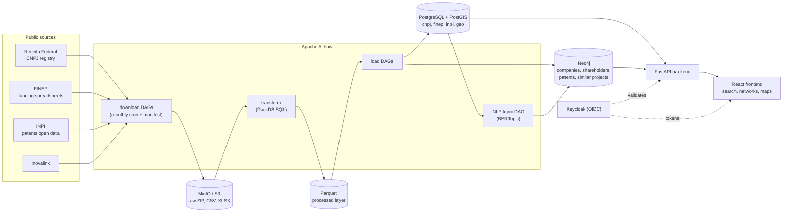

# OSINT Platform

An open-source intelligence platform for Brazilian public data. It ingests the federal company registry (CNPJ), FINEP innovation funding, INPI patents and Inovalink ecosystem data. It cleans the data at scale, then serves it as searchable relational tables and as a graph of company and shareholder relationships.

[Leia em português](README.pt-BR.md)

**Highlights**

- **Orchestrated ETL:** Apache Airflow DAGs for each source, from scheduled monthly downloads through transform and load to materialized-view refresh and graph loading.
- **Large-scale processing:** the CNPJ registry has tens of millions of companies and establishments. DuckDB SQL transforms one ~5M-row file in 3 to 4 seconds (about 4M rows/s), and Parquet shrinks it by about 70%.
- **Layered storage:** raw ZIPs and CSVs land in MinIO (S3 API) and are cleaned into Parquet, then loaded into PostgreSQL/PostGIS for search and Neo4j for networks.
- **Idempotent and traceable:** download manifests record every file and reference month, so nothing is downloaded or reprocessed twice. Changes on the source are detected with ETag/Last-Modified checks.
- **Schema as code:** Flyway migrations for each domain schema (`cnpj`, `finep`, `inpi`, `geo`, `inovalink`), plus Cypher scripts for Neo4j constraints and indexes.
- **NLP:** FINEP project texts are topic-modeled with multilingual sentence-transformers, UMAP, HDBSCAN and BERTopic. A k-NN similarity graph of projects is written to Neo4j.
- **Full stack:** a FastAPI backend, a React + Vite frontend (Cytoscape network graphs, Leaflet maps, ApexCharts) and Keycloak (OIDC) authentication.

## Architecture



### The CNPJ pipeline

| Step | DAG | What it does |
|---|---|---|
| Download | `cnpj_download` (monthly, on the 2nd at 02:00) | Watches the Receita Federal repository and streams new monthly ZIPs straight to MinIO (`osint-raw/cnpj/raw/{YYYY-MM}/`), then updates `cnpj.download_manifest` |
| Transform | `cnpj_transform` | Extracts the files to staging and cleans and validates them in pure DuckDB SQL, writing Parquet |
| Load | `cnpj_load_postgres` | Bulk-loads into the `cnpj` schema in PostgreSQL |
| Search index | `cnpj_matview_refresh` | Refreshes the `cnpj.mv_company_search` materialized views |
| Graph | `cnpj_load_neo4j` | Loads `Empresa`, `Estabelecimento` and shareholder (`Pessoa`) nodes and their relationships |

Benchmark from one file (`Empresas0.zip`, ~5M rows): 2 to 5 s extract, 3 to 4 s DuckDB transform, 10 to 20 s Postgres load and 30 to 60 s Neo4j load. A full run detects the latest month and runs the whole chain:

```bash
./pipelines/scripts/cnpj/run_pipeline.sh
```

FINEP and INPI follow the same pattern: a downloader with a manifest, then loaders for each dataset. See [`pipelines/dags/README_CNPJ_DAG.md`](pipelines/dags/README_CNPJ_DAG.md) for details.

## Tech stack

| Layer | Tools |
|---|---|
| Orchestration | Apache Airflow 2.10 |
| Processing | Python, DuckDB, pandas, PyArrow / Parquet |
| Storage | PostgreSQL 16 + PostGIS, Neo4j 5 (APOC), MinIO (S3), Redis |
| Schema management | Flyway, Cypher init scripts |
| NLP / ML | sentence-transformers, UMAP, HDBSCAN, BERTopic, scikit-learn |
| Backend | FastAPI, SQLAlchemy / asyncpg, Neo4j driver |
| Frontend | React 19, Vite, TypeScript, Cytoscape.js, Leaflet, ApexCharts |
| Auth | Keycloak 26 (OIDC) |
| Ops | Docker Compose (shared base plus dev and prod-like overrides), systemd units, GitHub Actions |

## Repository layout

| Directory | Role |
|---|---|
| [`pipelines/`](pipelines/) | Airflow DAGs (`dags/`) and the ETL scripts they call (`scripts/`): downloaders, cleaners, loaders and the NLP pipeline |
| [`backend/`](backend/) | FastAPI API: a stateless gateway over PostgreSQL and Neo4j, with no ETL logic |
| [`frontend/`](frontend/) | React + Vite dashboard: company and person search, network graphs, FINEP and INPI overviews |
| [`infrastructure/`](infrastructure/) | PostgreSQL migrations, Neo4j schema, Airflow image, Keycloak realm, systemd units |
| [`dev/`](dev/) | A lightweight replica of the stack with a small deterministic sample dataset |
| [`docs/`](docs/) | Architecture and implementation notes |

## Getting started

Requirements: Docker and Docker Compose. The full CNPJ dataset needs 32 GB+ RAM (64 GB recommended) and 150 GB+ of disk. The dev replica runs on much less.

### Dev replica (sample data)

The fastest way to try it. It uses separate ports and sample CNPJ, Neo4j and FINEP data:

```bash
cp dev/.env.example dev/.env
chmod +x dev/scripts/*.sh
./dev/scripts/start.sh                 # app stack only
./dev/scripts/start.sh --with-airflow  # plus the Airflow UI and workers
```

See [`dev/README.md`](dev/README.md).

### Production-like local stack

```bash
cp .env.example .env
./scripts/start-prod-like.sh --apply-migrations
```

This starts the frontend (`http://localhost:3000`), backend (`http://localhost:8000`), Keycloak (`http://localhost:8081`), MinIO console (`http://localhost:9001`), PostgreSQL, Neo4j, Redis and Flyway. Migrations are never applied implicitly: the script requires `--apply-migrations` or `--skip-migrations`.

Airflow is kept out of the default startup and can be started separately:

```bash
./scripts/start-prod-like.sh --skip-migrations --with-airflow
```

Load the canonical Brazilian geography (states, municipalities, CNPJ municipality mapping) into the `geo` schema:

```bash
sh infrastructure/postgres/run-geo-bootstrap.sh
```

The Keycloak realm imports a local-only default user (see `infrastructure/keycloak/realm/`). Change it before exposing the stack anywhere.

## Data sources

All data comes from Brazilian open-data portals:

- **CNPJ:** the Receita Federal company registry (companies, establishments, shareholders)
- **FINEP:** public spreadsheets of contracts and disbursements (`download.finep.gov.br`)
- **INPI:** patent data from [dadosabertos.inpi.gov.br](https://dadosabertos.inpi.gov.br/index/patentes/)
- **Geography:** IBGE boundaries via [geobr](https://github.com/ipeaGIT/geobr)

The shareholder records include names of real people, which are personal data under Brazil's LGPD even though they are published openly. The repository contains no real datasets: the dev seeds use fictitious people.

## Documentation

| Document | Content |
|---|---|
| [docs/repo/ARCHITECTURE_PLAN.md](docs/repo/ARCHITECTURE_PLAN.md) | Stack, architectural decisions, storage strategy |
| [docs/repo/IMPLEMENTATION_STEPS.md](docs/repo/IMPLEMENTATION_STEPS.md) | Environment, hardware, implementation status, operational commands |
| [pipelines/dags/README_CNPJ_DAG.md](pipelines/dags/README_CNPJ_DAG.md) | The CNPJ DAGs in detail, with benchmarks |
| [infrastructure/postgres/README.md](infrastructure/postgres/README.md) | PostgreSQL setup, CNPJ schemas, materialized views |
| [docs/repo/DOCKER_RESET_GUIDE.md](docs/repo/DOCKER_RESET_GUIDE.md) | Troubleshooting and a full container reset |

Most of the documentation in `docs/` is in Portuguese.

## Author

Rodrigo Fileto Cuerci Maciel ([@rodfileto](https://github.com/rodfileto))
