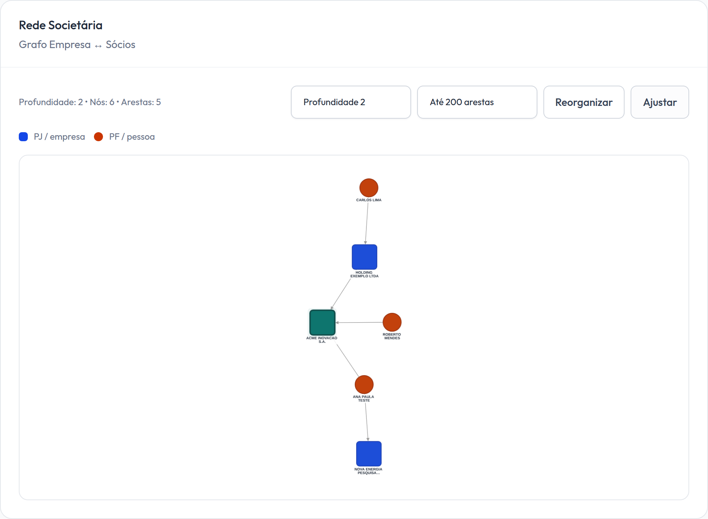
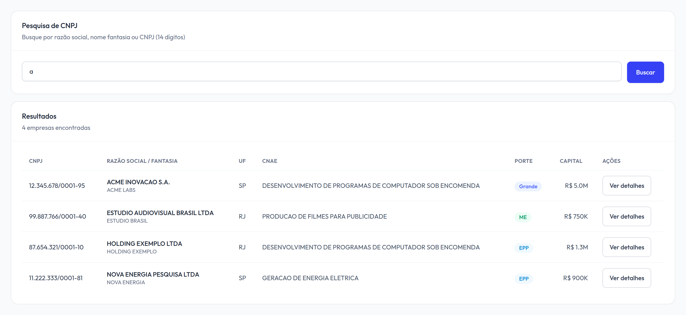
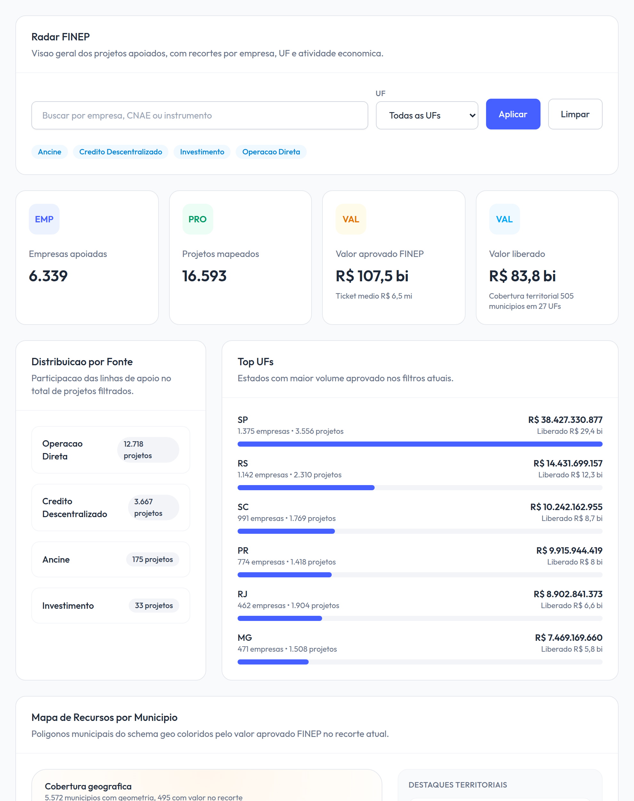
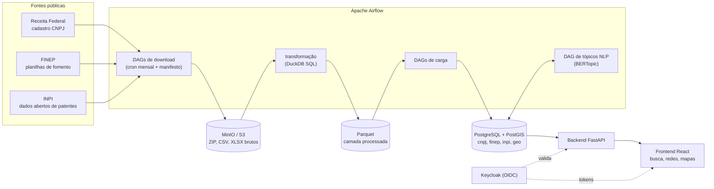

# OSINT Platform

[](https://github.com/rodfileto/osint-platform/actions/workflows/tests.yml)

Pesquise o cadastro de empresas do Brasil, veja quem é dono do quê e acompanhe o dinheiro público de inovação.

A plataforma ingere o cadastro federal de empresas (CNPJ: cerca de 28,5 milhões de registros de sócios), o fomento à inovação da FINEP e as patentes do INPI. O Airflow e o DuckDB os limpam todo mês para o PostgreSQL, e um app FastAPI + React oferece busca, redes societárias e mapas sobre eles.

[Read in English](README.md)

## Demo rápida

Precisa de Docker. Sobe uma cópia do stack com empresas e pessoas fictícias e os dados públicos completos da FINEP, em portas próprias:

```bash
git clone https://github.com/rodfileto/osint-platform.git && cd osint-platform
cp dev/.env.example dev/.env
./dev/scripts/start.sh
```

Depois de cerca de 7 minutos, abra `http://localhost:13000`, entre como `osint-admin` / `osint123`, pesquise `acme` e abra a empresa para ver a rede societária. Mais em [Primeiros passos](#primeiros-passos).

**Destaques**

- **ETL orquestrado:** DAGs do Apache Airflow para cada fonte, do download mensal agendado à transformação, carga e refresh de materialized views.
- **Processamento em larga escala:** o cadastro CNPJ tem dezenas de milhões de empresas e estabelecimentos. O DuckDB SQL transforma um arquivo de ~5 milhões de linhas em 3 a 4 segundos (cerca de 4 milhões de linhas/s), e o Parquet o reduz em cerca de 70%.
- **Armazenamento em camadas:** ZIPs e CSVs brutos chegam ao MinIO (API S3) e são limpos em Parquet, depois carregados no PostgreSQL/PostGIS, que atende busca, redes societárias e mapas.
- **Idempotente e rastreável:** manifestos de download registram cada arquivo e mês de referência, então nada é baixado ou reprocessado duas vezes. Mudanças na fonte são detectadas com verificações de ETag/Last-Modified.
- **Schema como código:** migrations Flyway para cada schema de domínio (`cnpj`, `finep`, `inpi`, `geo`).
- **NLP:** os textos dos projetos FINEP passam por modelagem de tópicos com sentence-transformers multilíngue, UMAP, HDBSCAN e BERTopic. A similaridade k-NN entre projetos fica no PostgreSQL.
- **Full stack:** backend FastAPI, frontend React + Vite (grafos de rede com Cytoscape, mapas com Leaflet, ApexCharts) e autenticação Keycloak (OIDC).

## Decisões de engenharia

- **Sem banco de grafos.** As redes societárias eram carregadas no Neo4j todo mês. Agora são montadas no PostgreSQL com uma consulta indexada por salto sobre os 28,5 milhões de registros de sócios: profundidade 3 em torno dos maiores hubs leva de 0,6 a 1,2 ms (p95) no banco e de 14 a 44 ms pela API. Um serviço e 56 GB de disco a menos, e nenhuma segunda cópia dos dados para manter sincronizada. Medições em [ARCHITECTURE_PLAN.md](docs/repo/ARCHITECTURE_PLAN.md#ownership-networks).
- **Busca que usa seus índices.** A busca de empresas varria as views de busca inteiras (17 a 30 s). Índices de prefixo nas colunas de CNPJ e a remoção de um `COALESCE` que escondia a coluna de nome do seu índice a trouxeram para 3 a 660 ms.
- **Uma DAG em vez de cinco.** A carga do CNPJ eram cinco DAGs encadeadas que passavam parâmetros como strings (então `'False'` contava como verdadeiro), baixavam cada ZIP duas vezes e marcavam arquivos como carregados antes do commit do upsert. Agora é um único `cnpj_pipeline` com parâmetros tipados e upserts com staging e deduplicação; a reescrita removeu 9.547 linhas e adicionou 1.510.
- **Guardar os arquivos brutos.** Os downloads ficam no MinIO como vieram da fonte, com um manifesto de cada arquivo e mês. O banco pode ser apagado e reconstruído sem baixar de novo: a reconstrução completa da versão 2026-10 levou 1 h 20 min para o CNPJ, 8 min para o INPI e menos de 1 min para a FINEP.
- **Testado a cada push.** O GitHub Actions roda os testes do SQL de limpeza do DuckDB e do loader da FINEP, as consultas de rede e busca contra o PostgreSQL com as migrations reais, e o build do frontend.

## Capturas de tela

Feitas na réplica de dev. As empresas e pessoas são fictícias; o painel FINEP usa a base pública completa da FINEP.

**Rede societária:** uma empresa, seus sócios e as outras empresas dos sócios (profundidade 2).



**Pesquisa de empresas** por nome ou CNPJ.



**Painel FINEP:** empresas e projetos apoiados, por linha de fomento e UF.



## Arquitetura



### O pipeline CNPJ

Uma DAG, `cnpj_pipeline`, roda mensalmente (no dia 2, às 02:00):

| Etapa | Tarefas | O que faz |
|---|---|---|
| Download | `download_release`, `update_manifest` | Transmite os ZIPs do release mais recente direto para o MinIO (`osint-raw/cnpj/raw/{AAAA-MM}/`) e os registra em `cnpj.download_manifest` |
| Seleção | `select_month` | Escolhe o mês a processar e pula o resto da execução se ele já estiver carregado |
| Transformação | `transform_file` (uma por ZIP) | Baixa o ZIP do MinIO, extrai, limpa e valida em DuckDB SQL puro, gravando Parquet |
| Carga | `load_reference_tables`, `load_empresa`, `load_simples_nacional`, `load_estabelecimento`, `load_socio` | Faz o staging de cada tabela, remove duplicatas e faz upsert no schema `cnpj` |
| Índice de busca | `refresh_search_views` | Atualiza as materialized views `cnpj.mv_company_search` |

Uma execução mensal leva cerca de 1 h 20 min quando o release já está no MinIO (veja [Quanto tempo leva uma carga completa](#quanto-tempo-leva-uma-carga-completa)). Para processar um mês específico de novo:

```bash
airflow dags trigger cnpj_pipeline --conf '{"reference_month": "2026-10", "force_reprocess": true}'
```

FINEP e INPI seguem o mesmo padrão: um downloader com manifesto, depois cargas para cada dataset. Veja [`pipelines/dags/README_CNPJ_DAG.md`](pipelines/dags/README_CNPJ_DAG.md) para detalhes.

## Stack técnico

| Camada | Ferramentas |
|---|---|
| Orquestração | Apache Airflow 2.10 |
| Processamento | Python, DuckDB, pandas, PyArrow / Parquet |
| Armazenamento | PostgreSQL 16 + PostGIS, MinIO (S3) |
| Gestão de schema | Flyway, scripts de inicialização Cypher |
| NLP / ML | sentence-transformers, UMAP, HDBSCAN, BERTopic, scikit-learn |
| Backend | FastAPI, SQLAlchemy / asyncpg |
| Frontend | React 19, Vite, TypeScript, Cytoscape.js, Leaflet, ApexCharts |
| Autenticação | Keycloak 26 (OIDC) |
| Operação | Docker Compose (base compartilhada mais overrides de dev e prod-like), unidades systemd, GitHub Actions |

## Estrutura do repositório

| Diretório | Papel |
|---|---|
| [`pipelines/`](pipelines/) | DAGs do Airflow (`dags/`) e os scripts de ETL que elas chamam (`scripts/`): downloaders, limpeza, cargas e o pipeline de NLP |
| [`backend/`](backend/) | API FastAPI: um gateway stateless sobre PostgreSQL, sem lógica de ETL |
| [`frontend/`](frontend/) | Dashboard React + Vite: busca de empresas e pessoas, grafos de rede, visões FINEP e INPI |
| [`infrastructure/`](infrastructure/) | Migrations do PostgreSQL, imagem do Airflow, realm do Keycloak, unidades systemd |
| [`dev/`](dev/) | Uma réplica leve do stack com um pequeno dataset de amostra determinístico |
| [`docs/`](docs/) | Notas de arquitetura e implementação |

## Primeiros passos

Requisitos: Docker e Docker Compose. Carregar o mês mais recente do CNPJ mais INPI e FINEP exige cerca de 105 GB de disco (150 GB recomendado para folga), e as configurações de memória padrão são dimensionadas para uma máquina de 32 GB; veja [Quanto tempo leva uma carga completa](#quanto-tempo-leva-uma-carga-completa). A réplica de dev roda com bem menos.

### Réplica de dev (dados de amostra)

A forma mais rápida de experimentar. Usa portas separadas, dados de amostra do CNPJ e os dados completos da FINEP:

```bash
cp dev/.env.example dev/.env
chmod +x dev/scripts/*.sh
./dev/scripts/start.sh                 # apenas o stack da aplicação
./dev/scripts/start.sh --with-airflow  # mais a UI e os workers do Airflow
```

Depois abra `http://localhost:13000` e entre como `osint-admin` / `osint123`. A primeira subida leva cerca de 7 minutos (build das imagens e download da FINEP); veja [`dev/README.md`](dev/README.md) para os outros logins e como parar.

### Stack local production-like

```bash
cp .env.example .env
./scripts/start-prod-like.sh --apply-migrations
```

Por padrão, os dados de todos os serviços (PostgreSQL, MinIO, Airflow) ficam em `./data/` dentro do repositório, e as configurações de memória são dimensionadas para uma máquina de 32 GB. Para carregar os datasets completos, aponte as variáveis `*_HOST_PATH` do `.env` para discos maiores e aumente a memória do PostgreSQL; o `.env.example` traz o perfil de 64 GB.

Isso sobe o frontend (`http://localhost:3000`), o backend (`http://localhost:8000`), o Keycloak (`http://localhost:8081`), o console do MinIO (`http://localhost:9001`), PostgreSQL e Flyway. Migrations nunca são aplicadas implicitamente: o script exige `--apply-migrations` ou `--skip-migrations`.

O Airflow fica fora do startup padrão e pode ser iniciado separadamente:

```bash
./scripts/start-prod-like.sh --skip-migrations --with-airflow
```

A geografia brasileira (estados e municípios do IBGE) é carregada automaticamente no schema `geo`: o serviço `geo-bootstrap` roda antes do backend a cada start e baixa as geometrias só na primeira vez. O `cnpj_pipeline` reconstrói o mapeamento de municípios do CNPJ após cada carga do CNPJ.

Para subir o stack no boot, instale as unidades systemd (elas são geradas com o caminho deste repositório):

```bash
sudo sh infrastructure/systemd/install-osint-platform-local.sh --start
sudo systemctl enable --now osint-platform-airflow.service   # opcional: Airflow no boot também
```

### Login

Abra `http://localhost:3000` e entre com o usuário local que o realm do Keycloak importa: `osint-admin` / `osint123`. Troque-o (veja `infrastructure/keycloak/realm/`) antes de expor o stack em qualquer lugar.

### Primeira carga de dados

O banco começa vazio e todas as DAGs são criadas pausadas. Cada fonte tem uma DAG de pipeline, e despausá-la já inicia a primeira execução:

```bash
C="docker compose --env-file .env -f docker-compose.yml -f compose.prod.yml"
for dag in cnpj_pipeline finep_pipeline inpi_pipeline; do $C exec airflow-scheduler airflow dags unpause $dag; done
```

`cnpj_pipeline` faz download → transformação → PostgreSQL → views de busca, `finep_pipeline` baixa as duas planilhas e carrega as 7 tabelas FINEP, e `inpi_pipeline` baixa os 10 CSVs de patentes e os carrega.

Os downloads podem ser repetidos com segurança: arquivos que já estão no MinIO são ignorados ou registrados sem novo download.

### Quanto tempo leva uma carga completa

Medido com as configurações de memória padrão do `.env.example`, dimensionadas para uma máquina de 32 GB (`shared_buffers` do PostgreSQL 2 GB, DuckDB 4 GB por tarefa de transformação); os containers usaram cerca de 12 GB. A máquina tem 8 núcleos e 60 GB de RAM, com PostgreSQL em NVMe e MinIO em HDD; a RAM livre serve de cache de arquivos do sistema operacional, então uma máquina com apenas 32 GB pode ser um pouco mais lenta. Carregando o release 2026-10 do CNPJ (o tempo de download é da primeira carga; as demais linhas são de uma carga do zero com os arquivos já no MinIO):

| Etapa | Tempo |
|---|---|
| Download do CNPJ: cerca de 7,3 GB, servidos pela Receita Federal a ~2,5 MB/s | ~1 h |
| Transformação do CNPJ: 37 ZIPs para Parquet, 4 por vez | 3 min |
| Carga do CNPJ no PostgreSQL: empresas 23 min, estabelecimentos 21, Simples 6, sócios 5, mapeamento de municípios 2 | ~58 min |
| Views de busca do CNPJ (`mv_company_search`, ativas e inativas) | 21 min |
| INPI: staging e publicação das 10 tabelas de patentes, refresh da view de busca | ~8 min, mais o download de cerca de 2,6 GB do INPI |
| FINEP: as duas planilhas, 7 tabelas | menos de 1 min |
| **Primeira execução do zero** | **cerca de 2 h 20 min**; os três pipelines rodam em paralelo e o CNPJ é o mais longo |
| **Execução mensal do CNPJ com o release já no MinIO** | **cerca de 1 h 20 min** |

Espaço em disco após essa carga:

| Dados | Tamanho |
|---|---|
| Bronze do CNPJ no MinIO, por release mensal | 7,3 GB |
| Bronze do INPI no MinIO, por snapshot (gravado só quando o conteúdo muda) | cerca de 2,6 GB |
| Parquet do CNPJ no volume temporário do Airflow | 5,1 GB |
| PostgreSQL: `cnpj` 79 GB (tabelas, índices e views de busca), `inpi` 4 GB, `finep` e `geo` abaixo de 100 MB | 83 GB |
| Espaço temporário de ordenação durante a carga de empresas | cerca de 6 GB |
| **Total** | **cerca de 105 GB**: 98 GB armazenados, mais cerca de 6 GB usados só durante a carga |

O perfil de 64 GB do `.env.example` acelera principalmente os upserts, a criação de índices e o refresh das views no PostgreSQL.

## Testes

`tests/` contém suítes pytest que a CI roda a cada push ([`.github/workflows/tests.yml`](.github/workflows/tests.yml)), junto com a checagem de tipos e o build do frontend:

- `tests/pipelines`: o SQL de limpeza em DuckDB (códigos, decimais brasileiros, datas, linhas inválidas), a extração Latin-1 dos ZIPs da Receita e o casamento de cabeçalhos do loader da FINEP. Precisa de `duckdb`, `openpyxl`, `psycopg2-binary` e `pytest`.
- `tests/backend`: a rede societária e a busca de empresas sobre um PostgreSQL com as migrations do Flyway e o seed de dev. Defina `POSTGRES_HOST` e as demais variáveis `POSTGRES_*`; sem elas a suíte é pulada.

```bash
pip install duckdb openpyxl psycopg2-binary pytest && pytest tests/pipelines
```

## Fontes de dados

Todos os dados vêm de portais brasileiros de dados abertos:

- **CNPJ:** o cadastro de empresas da Receita Federal (empresas, estabelecimentos, sócios)
- **FINEP:** planilhas públicas de contratações e liberações (`download.finep.gov.br`)
- **INPI:** dados de patentes em [dadosabertos.inpi.gov.br](https://dadosabertos.inpi.gov.br/index/patentes/)
- **Geografia:** limites do IBGE via [geobr](https://github.com/ipeaGIT/geobr)

Os registros de sócios incluem nomes de pessoas reais, que são dados pessoais pela LGPD mesmo sendo publicados abertamente. O repositório não contém datasets reais: as seeds de dev usam pessoas fictícias.

## Documentação

| Documento | Conteúdo |
|---|---|
| [docs/repo/ARCHITECTURE_PLAN.md](docs/repo/ARCHITECTURE_PLAN.md) | Stack, decisões arquiteturais, estratégia de armazenamento |
| [pipelines/dags/README_CNPJ_DAG.md](pipelines/dags/README_CNPJ_DAG.md) | As DAGs do CNPJ em detalhe, com benchmarks |
| [infrastructure/postgres/README.md](infrastructure/postgres/README.md) | Setup do PostgreSQL, schemas do CNPJ, materialized views |
| [docs/repo/DOCKER_RESET_GUIDE.md](docs/repo/DOCKER_RESET_GUIDE.md) | Troubleshooting e reset completo dos containers |

## Licença

Distribuído sob a [Apache License 2.0](LICENSE). Os datasets continuam sujeitos aos termos de seus publicadores.

## Autor

Rodrigo Fileto Cuerci Maciel ([@rodfileto](https://github.com/rodfileto))
